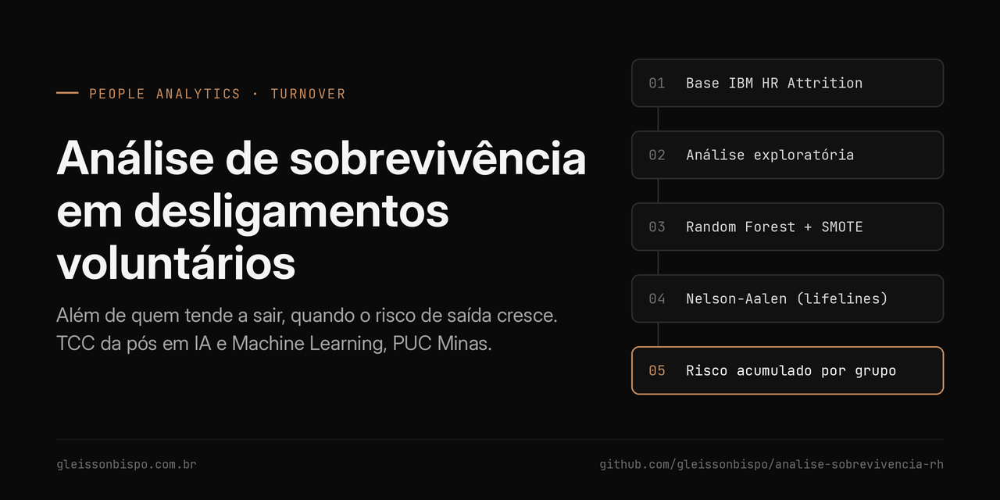
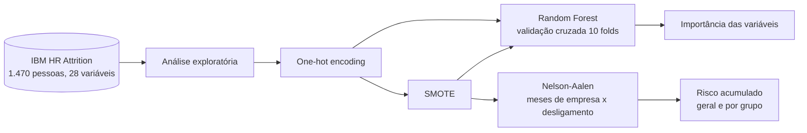
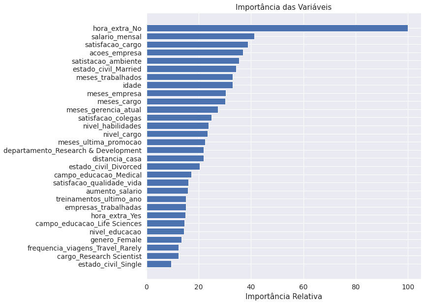
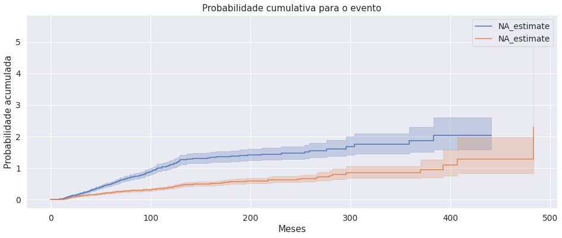

# Análise de sobrevivência aplicada a desligamentos voluntários

Trabalho de conclusão de curso da pós-graduação na PUC Minas (2021). O notebook combina um classificador de desligamento com análise de sobrevivência para responder a duas perguntas sobre turnover voluntário: quais fatores mais pesam na saída e em que momento do tempo de casa o risco cresce.

Notebook: [`TCC - PucMInas.ipynb`](TCC%20-%20PucMInas.ipynb)

## Problema

Os modelos de turnover mais comuns são classificadores: devolvem uma probabilidade de a pessoa sair. Isso ajuda a priorizar, mas não informa quando. Para o RH, o prazo muda a ação: um risco concentrado nos primeiros 12 meses pede revisão de onboarding e seleção; um risco que cresce depois do terceiro ano pede carreira e remuneração.

A análise de sobrevivência trata o tempo até o evento como variável de interesse e lida com censura, que é o caso de quem ainda está na empresa e cujo tempo final não se conhece.

## Solução

O notebook segue quatro etapas:

1. **Análise exploratória.** Estatística descritiva de cada variável, separando ativos e desligados, com teste de normalidade (Shapiro-Wilk), assimetria e curtose nas variáveis contínuas.
2. **Fatores associados à saída.** Random Forest com validação cruzada de 10 folds, primeiro na base original e depois na base balanceada com SMOTE. A importância das variáveis do modelo indica o que mais pesa.
3. **Curva de risco no tempo.** Estimador de Nelson-Aalen (`lifelines`) sobre os meses de empresa, com o desligamento como evento.
4. **Comparação entre grupos.** A mesma curva, separada por gênero, hora extra e faixa de idade (até 30 anos e acima).



## Dados

Base pública e fictícia [IBM HR Analytics Employee Attrition & Performance](https://www.kaggle.com/pavansubhasht/ibm-hr-analytics-attrition-dataset), em `data/ibm_df_attrition.csv`: 1.470 registros, 28 colunas, com nomes traduzidos para o português e as variáveis de tempo em meses. São 237 desligados (16,1%) e 1.233 ativos.

## Resultados

### Classificador

| Cenário | Acurácia | Precisão | Recall | F1 | ROC AUC |
|---|---|---|---|---|---|
| Base original | 0,863 | 0,818 | 0,194 | 0,262 | 0,810 |
| Base balanceada com SMOTE | 0,931 | 0,972 | 0,889 | 0,915 | 0,985 |

Na base original o modelo acerta 86% das vezes, mas encontra só 19% de quem saiu: a acurácia alta vem da classe majoritária. Os números do segundo cenário são otimistas, pelo motivo descrito em Limitações.

As variáveis com maior importância no modelo foram hora extra, salário mensal, satisfação com o cargo, ações da empresa e satisfação com o ambiente.



### Risco acumulado de desligamento (Nelson-Aalen)

| Grupo | 12 meses | 24 meses | 36 meses | 100 meses |
|---|---|---|---|---|
| Geral | 0,028 | 0,147 | 0,234 | 0,649 |
| Faz hora extra | 0,038 | 0,166 | 0,264 | 0,888 |
| Não faz hora extra | 0,015 | 0,082 | 0,132 | 0,284 |
| Até 30 anos | 0,075 | 0,336 | 0,504 | 1,303 |
| Acima de 30 anos | 0,012 | 0,074 | 0,126 | 0,455 |
| Homens | 0,035 | 0,142 | 0,197 | 0,585 |
| Mulheres | 0,008 | 0,083 | 0,131 | 0,300 |

Leitura: aos 36 meses de casa, o risco acumulado de quem faz hora extra é o dobro do de quem não faz (0,264 contra 0,132). Entre pessoas de até 30 anos, é quatro vezes o do grupo acima de 30 (0,504 contra 0,126).



No gráfico, a curva azul é o grupo que faz hora extra e a laranja, o que não faz.

## Como rodar

```bash
git clone https://github.com/gleissonbispo/analise-sobrevivencia-rh.git
cd analise-sobrevivencia-rh
python -m venv .venv && source .venv/bin/activate   # no Windows: .venv\Scripts\activate
pip install -r requirements.txt
jupyter notebook "TCC - PucMInas.ipynb"
```

O notebook foi escrito em Python 3.8 no início de 2021. O `requirements.txt` limita pandas e seaborn às versões em que as funções usadas ainda existem. O arquivo já está com todas as saídas, então dá para ler os resultados direto no GitHub sem executar nada.

## Limitações

- **Os valores da tabela de Nelson-Aalen são risco acumulado (cumulative hazard), não probabilidade.** Por isso passam de 1 em horizontes longos. Os títulos dos gráficos no notebook dizem "probabilidade", o que é impreciso. Para probabilidade de permanência, o estimador indicado é o Kaplan-Meier.
- **O SMOTE foi aplicado antes da validação cruzada.** Registros sintéticos derivados dos dados de validação entram no treino, e isso infla as métricas do cenário balanceado. O correto é balancear dentro de cada fold.
- **As curvas de sobrevivência foram ajustadas na base balanceada.** Com desligados sintéticos, o nível absoluto do risco fica acima do real. A comparação entre grupos continua informativa; o valor absoluto, não.
- A base é fictícia e pequena. Os achados ilustram o método e não se transferem para uma empresa real.
- As diferenças entre grupos não foram testadas formalmente (log-rank) nem controladas por outras variáveis.

## Próximos passos

- Refazer as curvas na base original com Kaplan-Meier e teste de log-rank.
- Ajustar um modelo de Cox para medir o efeito de cada variável controlando pelas demais.
- Colocar o SMOTE dentro de um `Pipeline` do `imbalanced-learn`, para que o balanceamento aconteça só no treino de cada fold.
- Testar modelos de sobrevivência baseados em árvores (Random Survival Forest).

## Autor

Gleisson Bispo · [gleissonbispo.com.br](https://gleissonbispo.com.br) · [LinkedIn](https://www.linkedin.com/in/gleissonbispo)
